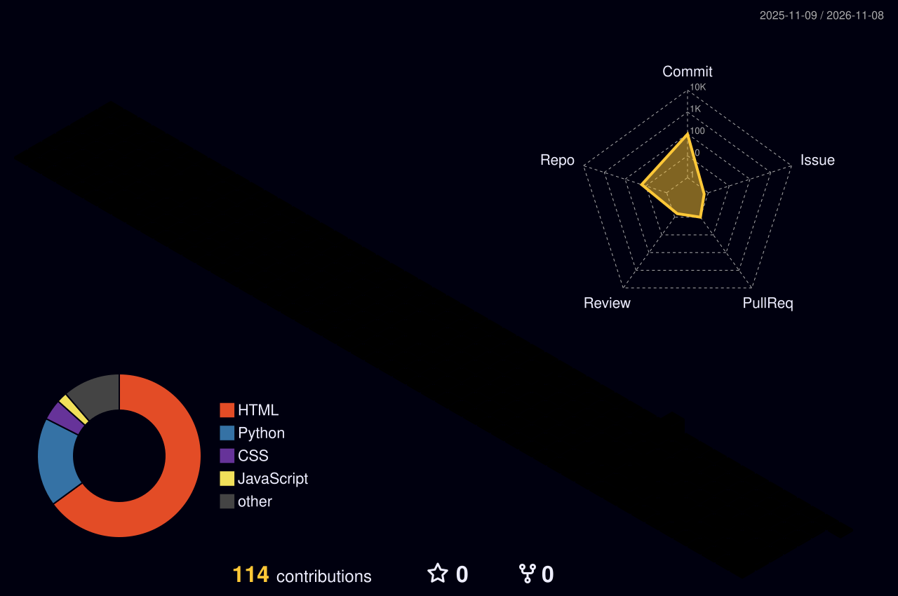

<!-- ═══════════ HEADER ═══════════ -->
<p align="center">
  
</p>

<p align="center">
  
  <br/>
  
</p>

<p align="center">
  <a href="https://github.com/Draco-afk">
    
  </a>
</p>

<p align="center">
  
</p>

---

### `$ whoami`

```yaml
name:      Yotsakorn Klahan
role:      CAI Student · Computer & AI
focus:     [ Web Apps ]

```

### `$ ls ./stack`

<p align="left">
  
  
  
  
  
  
  
  
  
  
</p>

### `$ ls ./projects`

<table>
<tr>
<td width="33%" valign="top">

**[⚡ FinFlow2](https://github.com/Draco-afk/FinFlow2)**<br/>
<sub>Personal finance flow web app</sub><br/><br/>


</td>
<td width="33%" valign="top">

**[🏋️ Industrial-Muscle-Fitness](https://github.com/Draco-afk/Industrial-Muscle-Fitness)**<br/>
<sub>Gym management system</sub><br/><br/>


</td>
<td width="33%" valign="top">

**[🛰️ thai-fakenews](https://github.com/SANTI-team/thai-fakenews)**<br/>
<sub>AI that detects Thai fake news · team project</sub><br/><br/>


</td>
</tr>
</table>

### `$ cat stats.log`

<p align="center">
  
  
</p>

<p align="center">
  
</p>

### `$ git log --graph`

<p align="center">
  
</p>

### `$ ./city --render 3d`

<p align="center">
  
</p>

### `$ snake --eat contributions`

<p align="center">
  
</p>

<!-- ═══════════ FOOTER ═══════════ -->
<p align="center">
  
</p>
